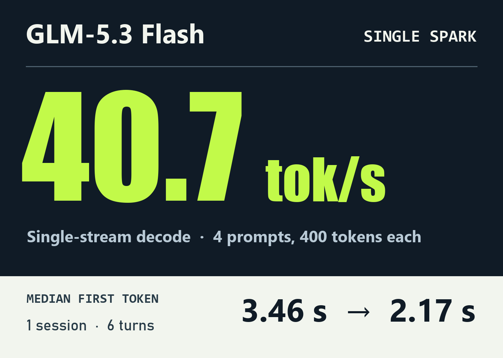

# GLM-5.3 Flash on a single Spark with GR8 turn-tail checkpoints

Run the text model on one NVIDIA GB10 with KindlingAI's EXLR8 bit201 checkpoint, INT4 KV cache and adaptive DFlash2 decoding. The turn-tail patch lets a follow-up request reuse more of the preceding prompt. This recipe uses the same engine source and cache settings as the November 18 ASUS Ascent GX10 comparison.

## 40.7 tok/s on a single Spark



On one ASUS GX10, single-stream decode averaged **40.71 tok/s** with turn-tail on and **40.83 tok/s** off across four prompt medians. In one six-turn session, median first-token wait fell from **3.46 s to 2.17 s**. At eight concurrent sessions, all eight opening turns missed the cache with turn-tail on, and the 48-turn replay took 268.8 s on versus 249.4 s off. Both arms used a fresh 4G SSD prompt cache.

[Full results and per-turn timings](results/2026-11-18-gx10/README.md) · [Result card](results/2026-11-18-gx10/turn-tail.png)

## Run it

Use a Linux aarch64 GB10 with Docker, NVIDIA Container Toolkit, Docker Buildx, Git, Bash, Python 3.9+ and `ss` (iproute2). The measured launcher checks for 108 GiB of available host memory at startup. KindlingAI's model and drafter download needs at least 87 GB of disk. Allow additional space for the 4G SSD cache, container layers and the compiler build cache. [Upstream hardware and storage requirements](https://github.com/kindlingai/glm-5.3-flash-exlr8-1x-spark/blob/30d5790d5720ef7a181217b93c6041c7814be90a/README.md#what-you-need)

On an idle Spark, clone the repository and launch the recipe. If you already extracted the recipe archive, run `bash run.sh` in the extracted directory.

```bash
git clone https://github.com/sxuff/glm53-flash-single-spark.git
cd glm53-flash-single-spark/gr8
bash run.sh
```

The launcher builds the image if needed, serves with turn-tail enabled, and verifies a chat response. For individual steps, use `bash build.sh`, `bash serve.sh on` and `python3 smoke.py on`. The build fetches a pinned GR8 checkout, verifies the source tree and patch, compiles the ARM64 engine, and overlays it on the pinned KindlingAI image. The server downloads the pinned target and drafter on first launch. The smoke check inspects the running engine's settings and waits for an actual chat answer. The model catalog can appear before the GPU worker is ready.

```bash
curl -sS http://127.0.0.1:8000/v1/chat/completions \
  -H 'Content-Type: application/json' \
  -d '{"model":"glm-5.3-flash","messages":[{"role":"user","content":"What is 2+2?"}],"max_tokens":128}'
```

To switch to the patch-off baseline, run `bash run.sh --stop`, then `bash run.sh off`. Use `bash run.sh --stop` to shut down either mode. The launcher defaults to port 8000, the `glm53f-cache` weight volume, and separate on/off prompt and runtime volumes. The image listens on the host network.

On the GX10 that produced these results, **`gr8-tail:2` is already built**. Use `export IMAGE=gr8-tail:2` for a new launch there. To verify the existing systemd-managed instance on port 8000, run `python3 smoke.py on --container glm53f-1x-spark`. Running a new instance on the same GB10 requires releasing the GPU first.

## Reproduce the comparison

With the GPU free, run the comparison from the recipe directory.

```bash
bash bench/compare.sh ./my-4g-comparison
python3 bench/summarize.py ./my-4g-comparison
```

Choose a new output directory for each comparison. The script downloads and verifies the small public input fixtures, shares the cached model weights, and allocates fresh benchmark prompt and runtime volumes for each arm. It runs **off, then on**, removes its temporary volumes, and keeps the measurements. To compare a specific local image, set `IMAGE` before running. The default benchmark HTTP port is 18100. [Benchmark inputs and individual commands](bench/README.md)

## What the patch changes

Stock GR8 captures aligned prompt checkpoints. With `GLMTAIL=1`, the scheduler can end a prefill step on the last eligible 64-token page boundary near the end of the prompt. On a follow-up with a matching prefix, the worker can restore that state and process a shorter suffix. A prompt that changes earlier in the conversation can reuse only its matching prefix.

GR8 marks these extra checkpoints as approximate. The persistent-store reload path rejects entries marked terminal, so the measurements cover a server that stays up throughout the conversation. The preserved aligned checkpoints use GR8's original behavior. The separate quality test performed November 17 scored 49/50 on multi-turn GSM8K in both modes at the earlier 12G SSD setting. The November 18 comparison measures the 4G setting and has no task-quality score. [Upstream reload validation](https://github.com/kindlingai/gr8/blob/d598965a1bbf3cd220ad9ad856bfd63da2466424/engine/runtime/s2/flash_ckpt_index.h#L135-L145)

| Setting | Measured value |
|---|---|
| Hardware | One ASUS Ascent GX10, NVIDIA GB10, 128 GB unified memory |
| Target | GLM-5.3-Flash, KindlingAI EXLR8 bit201 |
| Drafting | IncoAI DFlash2, adaptive, MTP 1 |
| Engine capacity setting | 327,680, eight session slots |
| Model length in the API catalog | 262,144 tokens |
| Prefill | One lane, 2,048 rows |
| KV cache | INT4, spare RAM floor 2G, persistent SSD tier 4G |
| Patch switch | `EXTRA_ENV=GLMTAIL=0` or `EXTRA_ENV=GLMTAIL=1` passed through the image entry point |

[Patch, upstream sources, image digests and credits](NOTICE.md)
